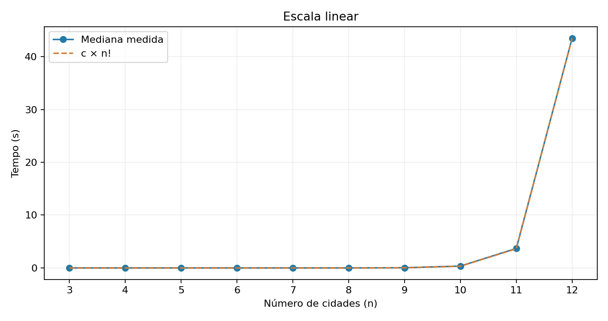
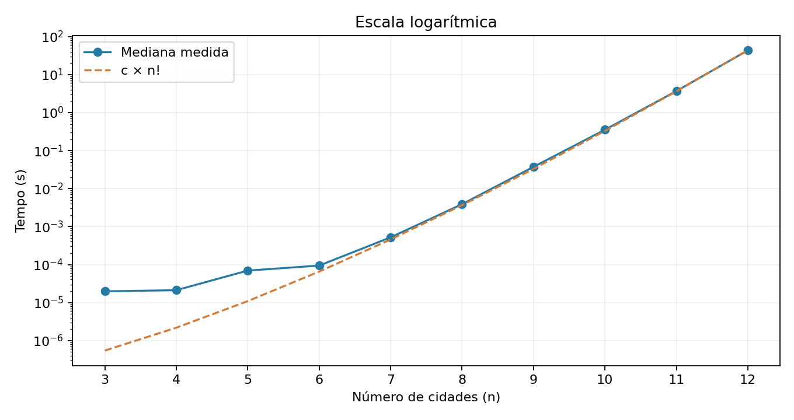
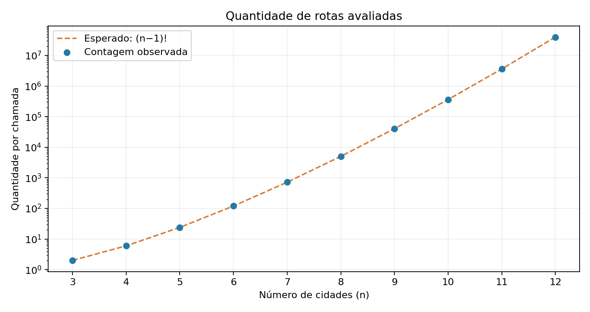
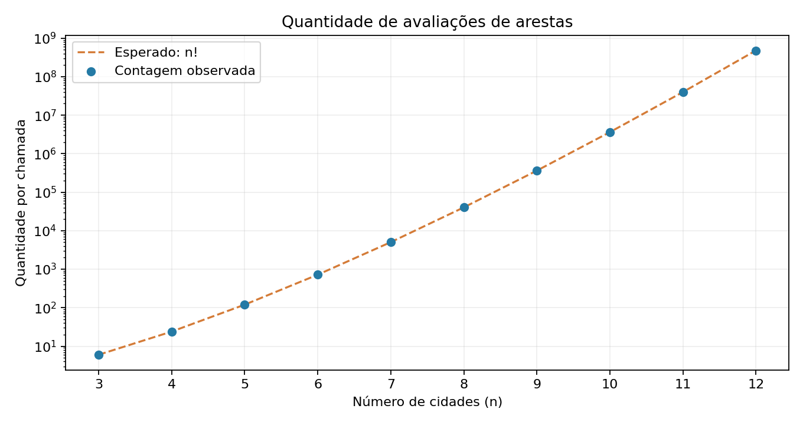
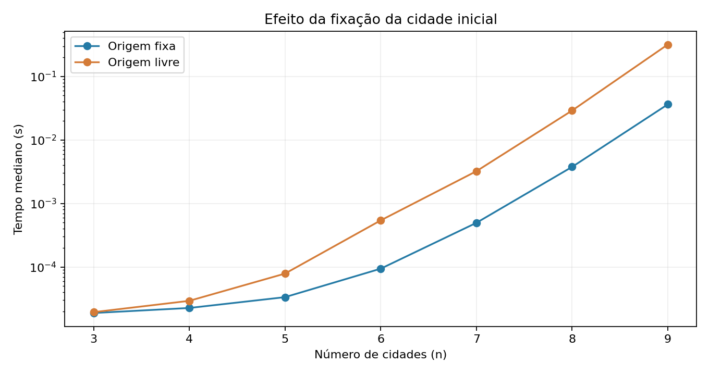
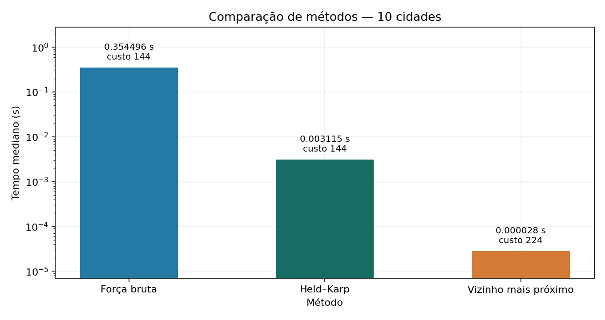

# Explorando a intratabilidade e a força bruta no Problema do Caixeiro Viajante

**Autor:** João Victor Piumbini Cheroto

**Disciplina:** Projeto e Análise de Algoritmos — Universidade de Vila Velha

**Data:** 05/11/2026

## 1. Introdução e objetivo

O Problema do Caixeiro Viajante (TSP) busca o circuito de menor custo que visite cada cidade uma vez e retorne à origem. Este trabalho implementa a força bruta e compara suas contagens e tempos de execução com a análise das seções 4.1 e 4.2 da Unidade 04.

## 2. Implementação e método experimental

O grafo completo é representado por uma matriz simétrica, com diagonal zero e custos inteiros de 1 a 100. A geração utiliza `random.Random(42)`, permitindo reproduzir as instâncias. Os custos não seguem necessariamente a desigualdade triangular. Para cada tamanho, a mesma matriz é usada em todas as repetições.

A cidade de índice 0, correspondente a v₁, permanece fixa. A função `resolver` percorre as permutações dos outros índices, calcula o custo de cada circuito e guarda o menor valor. A função `custo_rota` soma as n arestas, incluindo o retorno à origem. As permutações são geradas sob demanda, sem armazenar todas simultaneamente. Como o enunciado adota (n−1)! rotas, os dois sentidos de um circuito são avaliados mesmo no grafo simétrico.

Foram solicitadas instâncias de 3 a 13 cidades, com número de repetições igual a 3 por tamanho e limite de 90 segundos por execução. Os tamanhos de 3 a 12 foram concluídos integralmente. A medição usa `time.perf_counter()` dentro do processo de cálculo, incluindo validação da matriz, geração de permutações, avaliação, contagem e escolha do ótimo. A criação da matriz, o início do processo, a comunicação entre processos, a gravação dos arquivos e a geração dos gráficos ficam fora do tempo registrado no CSV.

As medições utilizaram Python 3.12.14. O ambiente de execução está registrado em `ambiente.json`. As chamadas são sequenciais, cada uma em um processo separado para permitir o encerramento por tempo. Hardware e carga do sistema influenciam as medições.

O CSV reúne os tempos individuais, a mediana, o mínimo e o máximo de cada tamanho concluído. As contagens são verificadas após cada chamada. Interrupções ficam registradas em `ambiente.json`.

## 3. Resultados experimentais

| n | Rotas = (n−1)! | Avaliações de arestas = n! | Mediana (s) | Custo ótimo |
|---|---:|---:|---:|---:|
| 3 | 2 | 6 | 0,000019809 | 101 |
| 4 | 6 | 24 | 0,000021172 | 150 |
| 5 | 24 | 120 | 0,000069493 | 98 |
| 6 | 120 | 720 | 0,000094060 | 157 |
| 7 | 720 | 5.040 | 0,000520400 | 106 |
| 8 | 5.040 | 40.320 | 0,003883072 | 127 |
| 9 | 40.320 | 362.880 | 0,037319908 | 178 |
| 10 | 362.880 | 3.628.800 | 0,353710332 | 144 |
| 11 | 3.628.800 | 39.916.800 | 3,686878526 | 135 |
| 12 | 39.916.800 | 479.001.600 | 43,504420408 | 182 |

As contagens coincidiram com as expressões teóricas em todas as repetições concluídas. O exemplo de n = 6 corresponde a 120 rotas e 720 arestas, conforme a seção 4.1.7 do material. Na maior instância concluída da coleta inicial, n = 12, a rota ótima foi 1-3-6-9-12-4-10-5-2-8-11-7-1, com custo 182. Os custos ótimos entre tamanhos não precisam crescer, pois as matrizes são distintas.

### Gráfico 1 — Tempo de execução — escala linear



Coleta inicial: mediana medida e curva c × n!, calibrada no maior tamanho concluído.

### Gráfico 2 — Tempo de execução — escala logarítmica



Os mesmos tempos em escala logarítmica, para comparar também os tamanhos menores.

### Gráfico 3 — Quantidade de rotas avaliadas



Contagem observada por chamada, comparada com (n−1)! na coleta inicial.

### Gráfico 4 — Quantidade de avaliações de arestas



Contagem observada por chamada, comparada com n! na coleta inicial.

### Gráfico 5 — Origem fixa e origem livre



Coleta complementar: tempos dos dois modos, com a mesma matriz e três repetições por tamanho.

### Gráfico 6 — Comparação dos métodos



Coleta complementar: força bruta, Held–Karp e vizinho mais próximo na mesma instância, com três repetições.

As coletas complementares dos gráficos 5 e 6 são independentes da tabela inicial e não entram na calibração de c.

**Fixação da origem:** coleta de 3 a 9 cidades, 3 repetições, semente 42, 42 chamadas completas. Python 3.12.14; ambiente registrado no arquivo da coleta. Registros em [origem.json](resultados/complementares/origem.json). Em n = 9, as medianas foram 0,036296 s com origem fixa e 0,317955 s com origem livre. A razão dos tempos foi 8,76, enquanto a razão das contagens de rotas foi exatamente 9.

**Métodos de solução:** coleta de 10 cidades, 3 repetições, semente 42, 9 chamadas completas. Python 3.12.14; ambiente registrado no arquivo da coleta. Registros em [metodos.json](resultados/complementares/metodos.json). Força bruta e Held–Karp encontraram custo 144; o vizinho mais próximo encontrou 224. O menor tempo do guloso não implica garantia de ótimo.

Fonte: resultados do experimento registrados em `benchmark.csv`.

A curva f(n) = c × n! usa c = 9.08231213e-08 s, calculado pela mediana do maior tamanho concluído dividida por seu fatorial. A coincidência nesse ponto é consequência da calibração. Os demais pontos permitem comparar a tendência, com maior influência dos custos fixos nos tamanhos pequenos. As medições são compatíveis com o crescimento fatorial; a demonstração de Θ(n!) vem da contagem de operações.

## 4. Análise e discussão

### 4.1. Redução do espaço de busca

Sem fixar a origem, seriam geradas n! permutações. Cada circuito orientado apareceria n vezes, uma por possível cidade de partida. Ao fixar v₁, restam (n−1)! rotas. A razão é n!/(n−1)! = n, ou seja, uma redução por um fator n. Para n = 10, a busca passa de 3.628.800 para 362.880 rotas, economia de 90%.

O teste `test_sem_fixacao` compara as duas estratégias em uma instância de cinco cidades: a enumeração sem fixação produz cinco vezes mais rotas e o mesmo custo ótimo. Na implementação principal, apenas os índices de 1 a n−1 são permutados. Para grafos simétricos, eliminar também os circuitos reversos permitiria uma redução adicional por dois; essa otimização não foi aplicada para manter a contagem solicitada.

### 4.2. Custo de avaliação e complexidade total

O laço de `custo_rota` executa n iterações, consultando e somando uma aresta em cada uma. A ligação da última cidade à primeira também é incluída. Assim, cada avaliação custa Θ(n), sob o modelo de operações de custo constante para os inteiros utilizados.

Com R = (n−1)! rotas, a quantidade de avaliações de arestas é A(n) = n × (n−1)! = n!. O quociente A(n)/R foi igual a n nos resultados. Portanto, o tempo da implementação é Θ(n!). A contagem n! não corresponde a todas as instruções da CPU: criação de tuplas, comparações e atualização de contadores também contribuem para o tempo.

A matriz ocupa Θ(n²) de memória. A geração e a avaliação usam espaço adicional linear em n, pois as rotas não são armazenadas simultaneamente.

### 4.3. Limiar prático da intratabilidade

A maior instância concluída na coleta inicial foi n = 12, com mediana de 43,504420 segundos. A tentativa com n = 13 foi encerrada pelo limite de 90 segundos na repetição 1. Esse limite considera também o início do processo. A execução foi interrompida sem determinar o ótimo. Não há mediana nem contagem completa para essa tentativa.

O limite de tempo foi o critério de parada da coleta inicial. Ele não determina o maior tamanho que a máquina conseguiria resolver com mais tempo.

**Execução completa para observar o limiar.** Uma nova coleta, separada da inicial, executou 12 e 13 cidades com uma repetição por tamanho, origem fixa, semente 42 e gerador da biblioteca Python 3.12.14. O ambiente e as amostras estão registrados em [limiar.json](resultados/complementares/limiar.json).

| n | Tempo medido (s) | Rotas avaliadas | Avaliações de arestas |
|---|---:|---:|---:|
| 12 | 46,280510 | 39.916.800 | 479.001.600 |
| 13 | 581,943944 | 479.001.600 | 6.227.020.800 |

A execução de 13 cidades terminou em 9,70 minutos e encontrou custo ótimo 156. A razão dos tempos entre 13 e 12 cidades foi 12,57, enquanto as avaliações de arestas aumentaram exatamente 13 vezes. A contagem cresce por um fator exato; os tempos também dependem da carga e dos custos da implementação. Esta coleta tem uma única execução por tamanho e não caracteriza a dispersão dos tempos. Seus resultados não foram incorporados às medianas nem à constante c da coleta inicial. Nesta coleta, 12 cidades ficaram abaixo de um minuto e 13 já exigiram minutos.

As projeções abaixo preservam a constante c da coleta inicial. O novo tempo de 13 cidades não foi incorporado à calibração:

| n | Rotas previstas | Avaliações de arestas previstas | Tempo projetado (s) |
|---|---:|---:|---:|
| 13 | 479.001.600 | 6.227.020.800 | 565,56 |
| 14 | 6.227.020.800 | 87.178.291.200 | 7.917,80 |
| 15 | 87.178.291.200 | 1.307.674.368.000 | 118.767,07 |

Ao acrescentar uma cidade, a contagem de avaliações cresce por um fator n+1. Esse comportamento explica por que poucos acréscimos podem levar a minutos ou horas. O Merge Sort, com Θ(n log n), apresenta crescimento muito menor. A recorrência T(n) = 2T(n−1) + c, discutida na seção 4.2.2, exemplifica Θ(2ⁿ); não descreve esta implementação do TSP, cujo crescimento é fatorial.

### 4.4. P, NP e limites das heurísticas

P reúne os problemas de decisão resolvíveis por um algoritmo determinístico em tempo polinomial. NP reúne os problemas cujas respostas positivas admitem certificados verificáveis em tempo polinomial. P está contida em NP. Isso não significa que todo problema em NP seja intratável. A versão de decisão do TSP pergunta se existe uma rota de custo no máximo B e é NP-completa. A versão de otimização, abordada neste trabalho, é NP-difícil.

Uma rota candidata permite calcular seu custo e verificar se ele respeita B em tempo polinomial. Esse procedimento não prova que a rota seja ótima. Não se conhece um algoritmo exato polinomial para o TSP geral, e P versus NP permanece em aberto. A análise desta força bruta não demonstra que todo algoritmo exato precise de tempo fatorial. A programação dinâmica, por exemplo, reduz o tempo para O(n² × 2ⁿ), ainda exponencial. Um algoritmo exato polinomial para o TSP geral resolveria sua versão de decisão e implicaria P = NP.

A heurística do vizinho mais próximo pode executar em O(n²) com uma matriz, mas escolhas locais não garantem o ótimo global. O exemplo abaixo, partindo de A, demonstra essa limitação:

| Cidade | A | B | C | D |
|---|---:|---:|---:|---:|
| A | 0 | 1 | 2 | 3 |
| B | 1 | 0 | 4 | 5 |
| C | 2 | 4 | 0 | 100 |
| D | 3 | 5 | 100 | 0 |

O vizinho mais próximo escolhe A→B→C→D→A, com custo 1+4+100+3 = 108. A rota A→C→B→D→A custa 2+4+5+3 = 14. A força bruta confirma que 14 é o ótimo. O exemplo utiliza custos sem a desigualdade triangular, conforme o modelo adotado.

Uma heurística aplica uma regra específica de busca, como escolher o vizinho mais próximo. Metaheurísticas orientam a exploração de soluções: a busca tabu usa memória para restringir movimentos; o recozimento simulado pode aceitar pioras para escapar de ótimos locais; algoritmos genéticos trabalham com populações de soluções. Essas estratégias não garantem, em geral, encontrar o ótimo global. Garantias de aproximação dependem do algoritmo e de hipóteses específicas sobre os custos.

## 5. Validação e reprodução

Os testes automatizados abrangem ótimo conhecido, fechamento do circuito, contagem fatorial, economia pela fixação da origem, empates, custos nulos, negativos e fracionários, entradas inválidas e preservação da matriz. Também comparam os resultados com uma referência independente por programação dinâmica em 20 matrizes assimétricas, de 3 a 7 cidades.

Os testes do benchmark verificam os argumentos, a gravação dos resultados e a preservação das chamadas concluídas após uma interrupção. O limite de tempo também é exercitado com um processo real. Os tempos da suíte de testes não compõem o benchmark.

Comandos de reprodução no PowerShell, executados na pasta do projeto:

```powershell
py -m venv .venv
.\.venv\Scripts\python.exe -m pip install -r requirements.txt
.\.venv\Scripts\python.exe -m unittest -v
.\.venv\Scripts\python.exe tsp.py --max-n 13 --repeticoes 3 --limite 90
.\.venv\Scripts\python.exe grafico.py
.\.venv\Scripts\python.exe relatorio.py
```

Após uma nova coleta, executar `grafico.py` e `relatorio.py` para atualizar os materiais com os tempos obtidos.

### 5.1. Aplicação local

A aplicação oferece demonstração de rotas, benchmark com e sem origem fixa e comparação com Held–Karp e vizinho mais próximo. A enumeração pode usar `itertools.permutations` ou trocas recursivas.

As coletas da interface ficam em `experimentos/` e não foram agregadas aos resultados da seção 3. No desenho da rota, as posições dos nós são ilustrativas; os custos vêm da matriz. As instruções de execução e exportação estão no README.

## 6. Conclusão

As contagens observadas confirmaram (n−1)! rotas e n! avaliações de arestas. Fixar a origem reduz o trabalho redundante, mas mantém a complexidade Θ(n!). A coleta complementar concluiu 13 cidades em 9,70 minutos, registrando diretamente o aumento para a escala de minutos. O crescimento fatorial limita a aplicação da força bruta, apesar da garantia de ótimo nas execuções completas. Heurísticas reduzem o custo da busca, mas não oferecem a mesma garantia em geral.

## Referência

UNIVERSIDADE VILA VELHA. **Unidade 04: Projeto e Análise de Algoritmos**. Material disponibilizado na disciplina, seções 4.1 e 4.2.
