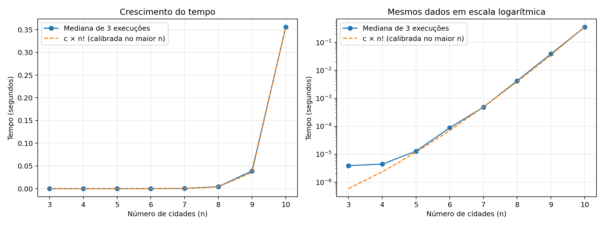

# Explorando a Intratabilidade e a Força Bruta no TSP

**Autor:** João Victor Piumbini Cheroto

**Disciplina:** Projeto e Análise de Algoritmos — Universidade de Vila Velha

**Data:** 05/11/2026

## 1. Objetivo e fundamentação

Este trabalho analisa a solução por força bruta para o Problema do Caixeiro Viajante (TSP), com o objetivo de comparar os resultados experimentais com a dedução apresentada nas seções 4.1.2–4.1.8 da Unidade 04. O circuito deve visitar todas as cidades uma única vez e retornar à origem, minimizando a soma dos custos.

A fixação de v₁ como origem restringe o espaço de busca a R = (n−1)! permutações. Cada circuito contém n arestas e sua avaliação custa Θ(n). Portanto, n × (n−1)! = n! avaliações de arestas e tempo Θ(n!). A operação adotada na contagem é a avaliação de uma aresta. Por isso, n! expressa essa contagem, enquanto o tempo em segundos depende do ambiente de execução.

## 2. Implementação e método experimental

As cidades são representadas por uma matriz simétrica de custos inteiros entre 1 e 100, com diagonal zero. A geração utiliza `random.Random(42)` para permitir a reprodução das instâncias. Os custos são abstratos e não estão sujeitos à desigualdade triangular. Para cada valor de n, a mesma matriz é utilizada nas três repetições.

A cidade de índice 0 (v₁) permanece fixa como ponto de partida. `itertools.permutations(range(1, n))` gera todas as permutações restantes, sem armazenar todas simultaneamente. `custo_rota` soma explicitamente as n arestas, incluindo a volta à origem. Durante a busca, o menor custo encontrado e a rota correspondente são armazenados. Embora o grafo seja simétrico, os dois sentidos de cada circuito são avaliados, de acordo com a contagem de (n−1)! estabelecida no enunciado.

O experimento compreendeu três execuções para cada valor de n entre 3 e 10, cronometradas com `time.perf_counter()`. A mediana é apresentada na tabela, enquanto os tempos mínimo e máximo estão registrados no arquivo CSV. O intervalo medido inclui a geração das permutações, a avaliação, a contagem e a seleção da melhor rota. A geração da matriz, a escrita em disco e a elaboração dos gráficos ficam fora desse intervalo. A contagem de operações foi mantida em todas as execuções, pois também influencia o tempo medido.

Os resultados analisados foram obtidos em um ambiente em nuvem com Linux x86_64 e Python 3.12.14. Essas condições delimitam a interpretação dos tempos, que podem variar conforme o hardware e a carga do sistema.

## 3. Resultados experimentais

| n | Rotas medidas = (n−1)! | Arestas medidas = n! | Mediana (s) | Custo ótimo |
|---|---:|---:|---:|---:|
| 3 | 2 | 6 | 0,000003926 | 101 |
| 4 | 6 | 24 | 0,000004436 | 150 |
| 5 | 24 | 120 | 0,000012889 | 98 |
| 6 | 120 | 720 | 0,000088411 | 157 |
| 7 | 720 | 5.040 | 0,000486821 | 106 |
| 8 | 5.040 | 40.320 | 0,004247971 | 127 |
| 9 | 40.320 | 362.880 | 0,038855178 | 178 |
| 10 | 362.880 | 3.628.800 | 0,355618710 | 144 |

As contagens experimentais coincidiram com as fórmulas em todas as repetições. Para n = 6, foram avaliadas 120 rotas e 720 arestas, conforme o exemplo da seção 4.1.7. Para n = 10, a rota ótima encontrada foi 1-4-3-5-10-2-7-6-9-8-1, com custo 144.



A comparação utiliza a função f(n) = c × n!, cuja constante foi calculada pela divisão da mediana de n = 10 por 10!. O valor obtido foi c ≈ 9,7999 × 10⁻⁸ segundos por avaliação de aresta. Como esse ponto foi utilizado na calibração, a comparação nos demais tamanhos permite avaliar a aderência à tendência teórica. Nas instâncias pequenas, o custo de preparação da execução e a precisão da medição têm maior influência relativa. Os resultados apresentam uma tendência compatível com o crescimento fatorial. A demonstração assintótica, por sua vez, decorre da contagem de rotas e arestas.

## 4. Análise e discussão

### 4.1. Economia ao fixar a cidade inicial

Sem a fixação da origem, a permutação de todas as cidades produziria n! rotas. Cada ciclo orientado aparece n vezes, uma por possível cidade inicial. A razão entre os espaços é n!/(n−1)! = n. Fixar v₁ reduz a quantidade por um fator n e economiza 1−1/n do total: para n = 10, de 3.628.800 para 362.880 rotas, redução de 90%. Se cada rota continuasse sendo avaliada em n arestas, o trabalho sem fixação seria n × n!, contra n! com fixação. O laço do programa permuta apenas os índices de 1 a n−1, e o contador confirma (n−1)!.

### 4.2. Custo linear por rota

O laço de `custo_rota` tem exatamente n iterações; cada uma consulta e soma uma aresta. A operação de módulo inclui a ligação da última cidade à primeira. Logo, o custo de uma avaliação é Θ(n), assumindo aritmética de custo constante para os pequenos inteiros usados. A razão entre a quantidade de arestas e a quantidade de rotas foi igual a n em todos os tamanhos analisados.

### 4.3. Limiar prático da intratabilidade

As execuções de n = 3 a 10 não atingiram a escala de minutos ou horas. A maior mediana foi de aproximadamente 0,355619 s. A tabela a seguir apresenta projeções calculadas por c × n! para discutir o limite prático. As instâncias maiores não foram executadas; portanto, esses valores representam estimativas, e não medições:

| n | Tempo projetado (s) | Interpretação aproximada |
|---|---:|---|
| 11 | 3,91 | segundos |
| 12 | 46,94 | menos de um minuto |
| 13 | 610,24 | cerca de 10 minutos |
| 14 | 8.543,38 | cerca de 2,4 horas |
| 15 | 128.150,76 | cerca de 35,6 horas |

O modelo prevê minutos a partir de n = 13 e horas a partir de n = 14 nesta implementação. Isso não é um limite universal. Ao acrescentar uma cidade, o trabalho fatorial cresce por um fator n+1. O Merge Sort exige Θ(n log n), que cresce muito mais lentamente. A recorrência T(n)=2T(n−1)+c da seção 4.2.2 exemplifica crescimento exponencial Θ(2ⁿ); ela não é a recorrência desta implementação do TSP, cujo crescimento é fatorial.

### 4.4. P versus NP e limites da heurística gananciosa

P e NP são classes de problemas de decisão, e P está contida em NP. NP não significa que todos os seus problemas sejam intratáveis. A versão de decisão do TSP pergunta se existe um circuito de custo no máximo B e é NP-completa; uma rota candidata permite verificar esse limite em tempo polinomial. A versão de otimização implementada aqui é NP-difícil. Verificar o custo de uma rota não é o mesmo que provar sua otimalidade.

Até hoje não se conhece um algoritmo exato polinomial para o TSP geral nem uma prova de P ≠ NP. A complexidade fatorial desta força bruta não prova que todo algoritmo de TSP precise de tempo fatorial. Programação dinâmica pode melhorar esse limite, ainda com tempo exponencial. Um algoritmo exato polinomial para o TSP geral implicaria P = NP.

A proposta de uma solução gananciosa pode ser examinada pela heurística do vizinho mais próximo. Com uma matriz de custos, sua execução pode ocorrer em O(n²), sem garantia de obtenção da rota ótima. O exemplo a seguir ilustra essa limitação, com partida em A:

| | A | B | C | D |
|---|---:|---:|---:|---:|
| A | 0 | 1 | 2 | 3 |
| B | 1 | 0 | 4 | 5 |
| C | 2 | 4 | 0 | 100 |
| D | 3 | 5 | 100 | 0 |

A heurística escolhe A→B→C→D→A, custo 1+4+100+3 = 108. Entretanto, A→C→B→D→A custa 2+4+5+3 = 14, e a força bruta confirma que 14 é ótimo. O teste automatizado desse exemplo confirmou os custos 108 e 14. Heurísticas e metaheurísticas podem buscar boas soluções com menor custo computacional, mas em geral não garantem o ótimo. Garantias de aproximação exigem algoritmos e hipóteses específicas; não decorrem apenas de usar uma estratégia gananciosa.

## 5. Conclusão

Os resultados confirmam a correspondência entre a implementação e a análise da Unidade 04: (n−1)! rotas, n avaliações por rota e crescimento total Θ(n!). A fixação da origem reduz o trabalho redundante, mas não elimina o crescimento fatorial. Até dez cidades, os tempos ficaram abaixo de um segundo; pelas projeções, poucos acréscimos no número de cidades já levariam a minutos ou horas. A força bruta permite obter o ótimo e verificar a dedução teórica em instâncias pequenas, mas seu crescimento fatorial limita a aplicação em problemas maiores.

## 6. Reprodução e validação

```bash
python3 -m unittest -v
python3 tsp.py --max-n 10 --repeticoes 3
python3 grafico.py
```

A correção foi verificada por quatro testes: uma instância com ótimo conhecido de custo 80, o retorno à origem em uma matriz assimétrica, as contagens fatoriais de n = 3 a 7 e o contraexemplo da heurística. Os quatro testes foram aprovados. O benchmark também confirmou as contagens de n = 3 a 10. A geração do gráfico utiliza a biblioteca Matplotlib.

## Referência

Material da disciplina Projeto e Análise de Algoritmos, Universidade de Vila Velha. **Unidade 04**, arquivo fornecido `Unidade_04 (6).pdf`, seções 4.1.2–4.1.9 e 4.2. Consultado em 05/11/2026.
